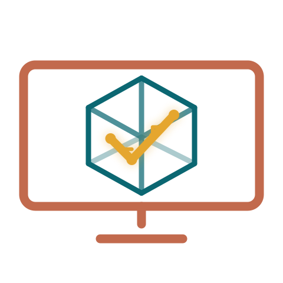
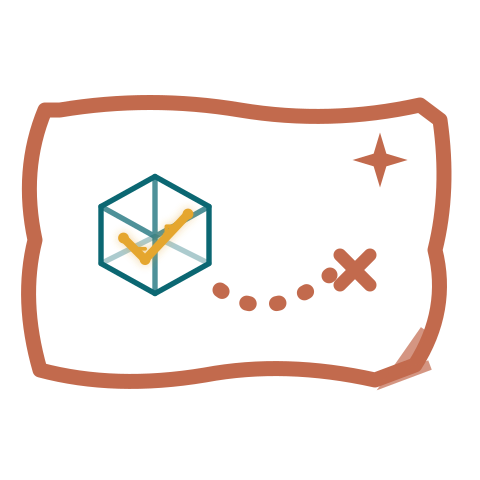

# Bastion Fold — Entertainment

The entertainment arm of [Bastion Fold LLC](https://github.com/BastionFold):
where tracking what you watch turns into stories you can step inside.
Live pages: [bastion-fold-site.workers.dev/entertainment](https://www.bastion-fold-site.workers.dev/entertainment/)

## The three projects

### Endless Watch (TV Time, but better)

A local-first media tracker that auto-logs what you watch across 10
streaming services and keeps your library yours — no subscription, no
cloud lock-in, works offline.

- Public shell: [matrixbuilderops/endless-watch](https://github.com/matrixbuilderops/endless-watch)
- On the site: [/entertainment/tv-time/](https://www.bastion-fold-site.workers.dev/entertainment/tv-time/)

### Questline

Build-your-own-adventure with real dice underneath: d20 mechanics and an
AI Dungeon Master spin branching quests you actually play, not just read.
Runs as a single file in your browser; live-AI play is metered.

- On the site: [/entertainment/questline/](https://www.bastion-fold-site.workers.dev/entertainment/questline/)

### StoryVerse

The unified platform where the tracker and the adventures meet — your
watch history on one side, a library of living stories on the other.
Watch something, then step inside it.

- On the site: [/entertainment/storyverse/](https://www.bastion-fold-site.workers.dev/entertainment/storyverse/)

---

Logos are the locked Bastion Fold family: the company cube sits entire
inside the clapperboard (division) and inside each project's object —
the TV, the pirate map, and the open book.

## Bastion Fold path

[Bastion Fold general hub](https://www.bastion-fold-site.workers.dev/) -> **Entertainment** (this repo) -> Endless Watch, Questline, and StoryVerse above.

- Entertainment pricing: [https://www.bastion-fold-site.workers.dev/pricing/#entertainment](https://www.bastion-fold-site.workers.dev/pricing/#entertainment)
- Other branch hubs: [CLI Hub](https://www.bastion-fold-site.workers.dev/hubs/) · [Global Projects](https://www.bastion-fold-site.workers.dev/global/)
- Private branch stack: Global-entertainment-hub and entertainment-system (indexes)
